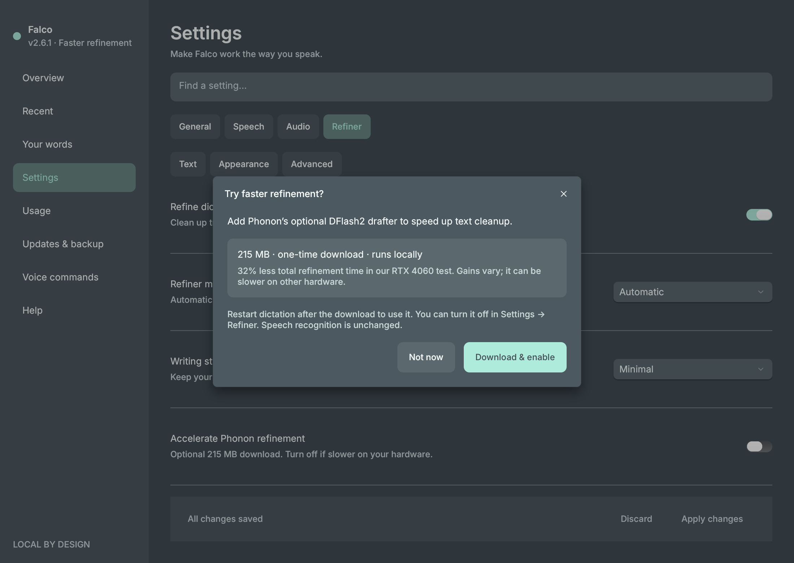
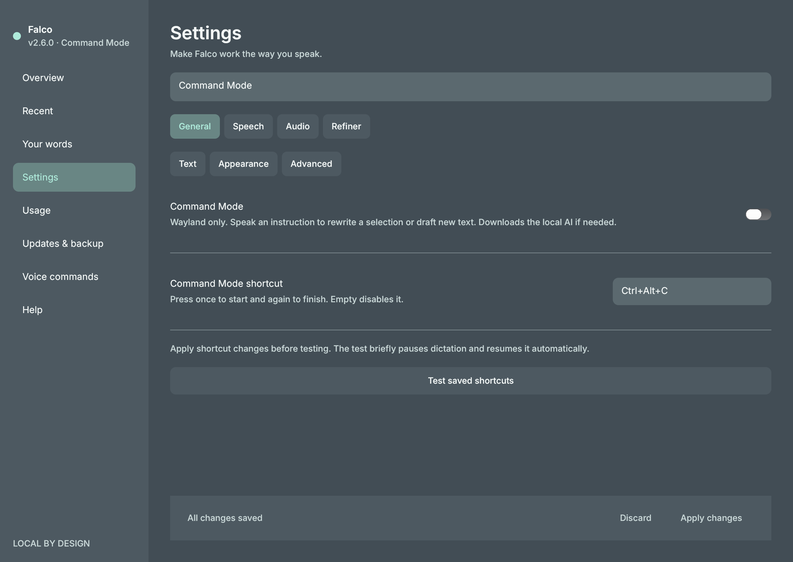
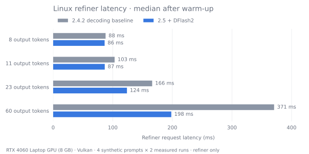

# Falco

[**2.6.1 — Faster refinement**](https://github.com/Lothnic/falco/releases/tag/v2.6.1)

Falco is a local voice dictation app for Linux. Hold a dictation key, speak,
and the text is typed into the application you are using. Speech recognition
runs on your machine, with optional local transcript cleanup; models are
downloaded once.

It is an experimental community app built on
[TuxTalk](https://github.com/ronb1964/TuxTalk), in a fork of the
[Phonon](https://github.com/Infatoshi/phonon) repository. It uses Phonon's
separately distributed
[refiner](https://huggingface.co/Infatoshi/phonon-refiner-1.7b) for optional
cleanup and adds a Rune dashboard and recording overlay. Falco is not an
official Phonon or TuxTalk release.

[Website](https://falco.lothnic.dev) · [Full Linux guide](linux/README.md) · [Upstream Phonon README](UPSTREAM-README.md)

## Features

- **Dictate anywhere.** Hold a configurable key to talk, or use a toggle key.
  Falco types into the focused app on Wayland and X11.
- **On-device speech recognition.** Parakeet Ultra v3 is the default and runs
  on the CPU or through Vulkan. Whisper models cover more languages and can
  use CUDA.
- **Optional local cleanup.** The Phonon refiner fixes self-corrections,
  removes fillers and false starts, and tidies capitalization. The refiner is
  English-only, and dictation uses the raw transcript until it is installed.
  Choose a writing mode in Settings → Refiner, or let Falco match
  supported chat, mail, terminal, and coding apps.
- **Your vocabulary.** Custom words steer recognition, and voice commands
  handle punctuation, formatting, undo, and "fix that word". Falco Labs adds
  optional voice editing, selection, and app, window, key, and mouse control.
- **Command Mode.** Select text and say how to change it, or say what to write
  with nothing selected. The local AI rewrites the selection or drafts at the
  cursor; existing voice commands keep working.
- **Rune dashboard and overlay.** Settings, pronunciations, snippets, usage, updates and backups
  share one dark slate-and-mint window, plus a sound-responsive recording overlay. Search the current
  session's dictations in Recent. An optional live transcript shows the
  latest words while you speak with Parakeet on the CPU. The GTK tray and
  recording indicator remain the fallback.
- **Private by design.** Audio and transcripts stay on the machine. No account
  is required, and dictation needs no network once the models are downloaded.
- **Short wait after the key.** With **Start typing sooner** on (Settings → Audio), Falco hears each phrase as you pause, so releasing the
  key only transcribes the last one. A long dictation no longer means a long
  wait. The text is spliced at the pauses you made, and the whole recording is
  transcribed as before if a splice can't be vouched for. With the refiner on,
  the cleaned-up text is worked out during the recording too, and reused at
  release when the transcript and refinement settings match.
- **A command line.** `falco transcribe talk.mp4` writes a file's text or
  subtitles, with no window and no running app, so it works in a script or
  over SSH. `falco --toggle` and `falco --start`/`--stop` drive the running
  app.

## Falco 2.6.1 — Faster refinement

Rune now offers **Try faster refinement?** once Phonon is installed and a local
AI feature is active. Choose **Download & enable** for the optional 215 MB
DFlash2 drafter, or **Not now** to keep your setup. Nothing downloads until you
accept. After success, restart dictation when ready; an ongoing recording is
never restarted by the offer. You can enable or disable it later in
**Settings → Refiner**. The offer waits while you record, download or have
unsaved settings, and appears when you open Overview or Settings.

This patch also fixes model downloads from Rune failing with
`'Cancellation' object has no attribute 'wait'`, preserves useful download
errors, and removes the stale “Working…” notice after an operation finishes.

DFlash accelerates Phonon's text cleanup. No compatible Parakeet Ultra drafter
was found for Falco's current ONNX/Vulkan backends; speech recognition keeps its
existing engine. [Research and alternatives](docs/research/parakeet-acceleration-2.6.1.md).



[2.6.1 release notes](docs/releases/v2.6.1.md)

## Falco 2.6.0 — Command Mode

Command Mode turns a spoken instruction into an edit or a new draft. Select
text, press **Ctrl+Alt+C** (or your own shortcut), say **make this shorter**,
and press it again. With nothing selected, say **a short note saying the deploy
moved to Friday** and the local AI writes it at the cursor. Existing voice
commands such as **open Firefox** still run, and drafts never leave the machine.

The feature is opt-in under **Settings → General**, in both
Rune and the GTK compatibility window. Command Mode is off by default, so
existing dictation and voice editing behave as before. Like voice editing, it
needs a Wayland session and does not automatically submit drafts.



[2.6.0 release notes](docs/releases/v2.6.0.md)

### Refiner edition features

Falco **2.5 — Refiner edition** adds optional Phonon acceleration and streamed
cleanup previews. In **Settings → Refiner**, enable **Accelerate Phonon
refinement** to download its matching DFlash2 drafter (215 MB).
Speed depends on the hardware; ordinary decoding remains available and is
used automatically if acceleration fails to start.

Enable **Show a live transcript in Rune** under **Settings → Appearance** to see cleanup arrive while finishing. Also enable **Start typing
sooner** for refinement during speech pauses with CPU Parakeet. Preview text
can change as you continue speaking; only completed, checked text is typed
into the focused app.

## Initial Linux benchmark

With the optional drafter enabled, Falco 2.5 used **32% less total
refiner-request time (1.47× faster)** than the v2.4.2 decoding baseline in
this initial test. The longest measured output, 60 tokens, finished in
**198 ms versus 371 ms (1.87× faster)**. Very short output changed little.



Measured on Linux/Vulkan with an **RTX 4060 Laptop GPU (8 GB)**, using the
same pinned Phonon target and llama.cpp b12210. Four synthetic English
prompts, two measured runs each after warm-up; outputs matched. Streamed
text first arrived in approximately **47–51 ms**, before overlay rendering.

These are **refiner-only** timings, excluding speech recognition, model loading,
UI rendering and text insertion. CPU-only and very long outputs have not yet
been measured. [Results, raw data and reproduction instructions](docs/benchmarks/README.md).

## How it works

```text
microphone → Parakeet Ultra or Whisper → cleanup rules → optional refiner → focused app
```

On first run, Falco downloads the default speech model (about **670 MB**)
and offers a test dictation. To add cleanup, open
**Settings → Refiner** and enable **Refine dictation**; the app offers a one-time download of about 1 GB for the refiner and
its llama.cpp engine.

Recent dictations in the Rune dashboard are session data, kept only in memory
for the current login; they are not saved as a permanent history.

## Requirements

- Linux with Python 3.10–3.14 and GTK 3. Ubuntu is the primary tested
  distribution; GNOME and KDE Plasma on Wayland or X11 are the intended
  environments.
- PyGObject, D-Bus, evdev, PortAudio, and `wl-clipboard`. The apt command
  below installs these.
- Prebuilt Rune UI: Linux x86_64 with glibc 2.39+ (built on Ubuntu 24.04).
  Rust 1.99.1 or newer is needed only for source builds. Other systems can
  build Rune locally or use the GTK compatibility interface.
- About 670 MB to download the default speech model. The optional refiner
  and its engine add about 1 GB.

Falco needs access to keyboard events and virtual input to read the dictation
key and type into other applications. The first-run screens guide you through
the permissions it needs.

## Install

The quick installer handles the system packages and the app in one command:

```bash
curl -fsSL https://falco.lothnic.dev/install.sh | bash
```

It supports apt, dnf, pacman, and zypper, installs the dependencies with
`sudo`, and then installs Falco and the matching Rune dashboard under your
user account on Linux x86_64. To build the UI locally instead, add
`--with-rune` (Rust 1.99.1 or newer):

```bash
curl -fsSL https://falco.lothnic.dev/install.sh | bash -s -- --with-rune
```

The installer uses the latest published release tag. Until a release is
published, it uses the preview from `main`. Use `--ref` to choose a specific
tag, branch, or commit. Use `--no-deps` if you manage the system packages
yourself. You can download and read the Bash script before running it.

For a verified **0.1.0** installation, the installer removes the old app and
its owned launchers before a fresh install. Settings and models stay; other
versions use the normal upgrade path. A failed reinstall restores the old app.

Run the same command again to upgrade. Quit and reopen Falco afterwards. If an install fails, you can retry it. Falco
keeps the existing launcher active until the new release is ready and
keeps previous releases in `~/.local/share/falco-app/releases`.

### Manual install

Install the system packages (package names vary by distribution):

```bash
sudo apt install python3 python3-venv python3-pip python3-gi python3-gi-cairo \
  python3-dbus python3-evdev gir1.2-gtk-3.0 \
  gir1.2-ayatanaappindicator3-0.1 libportaudio2 wl-clipboard
```

Clone and install:

```bash
git clone https://github.com/Lothnic/falco.git
cd falco

# Optional: build the Rune dashboard and recording overlay.
./linux/packaging/build-rune-bundle.sh

# Installs under ~/.local/share/falco-app and adds ~/.local/bin/falco.
./linux/install.sh
```

Start **Falco** from your application menu, or run `falco` (use
`~/.local/bin/falco` if that directory is not on your `PATH`). The first-run
screens configure permissions, a dictation key, and a speech model, then
offer a field to check that your words are typed. If both
Rune binaries are present, the launcher opens the Rune dashboard; otherwise
it opens the GTK tray interface.

To upgrade a checkout install, check out the desired revision and rerun
`./linux/install.sh`. It accepts only a matching UI build or release bundle.

## Development

Set up a development environment from a checkout:

```bash
cd linux
python3 -m venv --system-site-packages .venv
.venv/bin/pip install -e .
.venv/bin/python -m localdictation.tray
```

Run the Linux tests (from `linux/`):

```bash
.venv/bin/pip install pytest
PYTHONPATH=src .venv/bin/python -m pytest tests
```

To include the setup screen's X11 typing test, run the suite with
`GDK_BACKEND=x11 xvfb-run -a` before the Python command. This test uses
`xvfb`, `xauth`, and `xdotool`.

Build and test the Rune UI (from the repository root):

```bash
cargo build --release --locked --manifest-path linux/rune-overlay/Cargo.toml
cargo test --manifest-path linux/rune-overlay/Cargo.toml
```

Build and test the website:

```bash
cd website
npm install
npm test
```

`localdictation` is Falco's internal Python package name, retained from
TuxTalk.

## Repository layout

Only `linux/` is the Falco application. `website/` is the Falco landing page and
browser demo. The remaining code is the upstream Phonon source, kept for
history and reference under its own licenses.

| Path | Contents |
| --- | --- |
| `linux/` | Falco: Python dictation service, tray and preferences, Rune dashboard and overlay |
| `crates/` | Phonon Rust workspace: audio, ASR, refiner, pipeline, CLI, and Windows app |
| `bar/` | Phonon macOS Swift app and capsule |
| `sidecar/` | Phonon speech and refiner sidecars |
| `engine/` | Phonon native refiner engine |
| `ml/` | Phonon refiner training and evaluation pipeline |
| `android/` | Phonon Android keyboard (development build) |
| `ios/` | Phonon iPhone keyboard (development build) |
| `website/` | Falco landing page, browser dictation demo, and hosted `install.sh` |

`UPSTREAM-README.md` holds the Phonon README this fork started from. `SPEC.md`
and `DISTRIBUTION.md` document the upstream macOS and Windows projects and do
not describe Falco.

## Status

Falco is an early source package. Transcription and cleanup have been tested
on Ubuntu, but the packaged app still needs broader end-to-end testing across
desktop environments. The Rune dashboard and overlay, type-at-pause, and voice
editing are experimental. Falco is not a port of the full upstream Phonon
pipeline; it uses the refiner as an optional cleanup stage.

## License

The Falco code in `linux/` is MIT-licensed, based on TuxTalk, copyright
2024–2026 Ron Brand. See [`linux/LICENSE`](linux/LICENSE). The upstream Phonon
source elsewhere in the repository remains GPL-3.0 under the root
[`LICENSE`](LICENSE); `linux/` does not relicense it.

Model weights are downloaded separately and keep their own licenses. The
Phonon refiner is under the LFM Open License, which restricts commercial use
by larger organizations; Parakeet is CC-BY-4.0; llama.cpp is MIT. See the
[Phonon refiner model card](https://huggingface.co/Infatoshi/phonon-refiner-1.7b),
[`linux/README.md`](linux/README.md), and [`THIRD_PARTY.md`](THIRD_PARTY.md).
