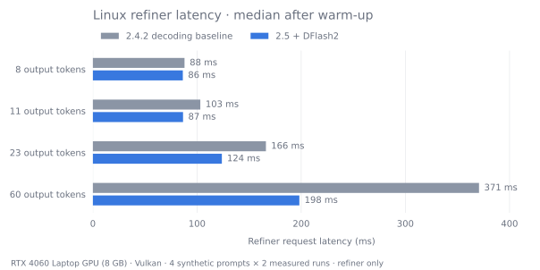

# Falco 2.5 Linux refiner benchmark

The 2.5 refiner engine (also included in 2.5.1) with its optional DFlash2 drafter reduced total refiner-request time by
**32% (1.47× faster)** across this initial local test. Gains increased with
output length in the four prompts measured. The longest output, 60 tokens,
finished **46.5% sooner (1.87× faster)**. Very short output changed little.



| Generated output | 2.4.2 decoding baseline | 2.5 + DFlash2 | Speedup |
| --- | ---: | ---: | ---: |
| 8 tokens | 87.97 ms | 86.35 ms | 1.02× |
| 11 tokens | 103.14 ms | 86.56 ms | 1.19× |
| 23 tokens | 166.12 ms | 123.82 ms | 1.34× |
| 60 tokens | 370.70 ms | 198.22 ms | 1.87× |

Rows report the median of two complete-response requests per prompt after
warm-up. The 32% aggregate reduction compares the sum of all eight complete
requests per configuration, rather than averaging the row speedups. Streamed
text first arrived in approximately **47–51 ms**; first-token generation was
similar in both configurations, while 2.5 can expose that text progressively.
This is server text arrival, before any overlay rendering overhead.

## Method and scope

- Measured on **2026-11-24**, Linux, **NVIDIA RTX 4060 Laptop GPU, 8 GB**, Vulkan.
- Same llama.cpp **b12210**, pinned Phonon Q4_K_S target, prompts, greedy decoding,
  context size and request settings. The accelerated configuration additionally
  loads the matching DFlash2 drafter, uses a seven-token draft limit and explicitly
  enables flash attention. The ordinary configuration keeps the app's default
  attention setting. These compare the app configurations as shipped.
- Target and drafter are pinned to Phonon revision
  `b20b28075046af94056ab5d5bff89a7abc0f6f50`; hashes are in the raw data.
- Baseline uses v2.4.2's decoding configuration and server code. This is a
  refiner-engine comparison, rather than an end-to-end run of both app releases.
- Four synthetic English dictations, one warm-up round and two measured rounds
  per configuration. Each round makes a complete-response request and a streamed
  request for each prompt. Baseline runs first, then the accelerated configuration.
- The JSON records client wall time, server timings and draft acceptance counters.
  Complete and streamed answers matched, and both configurations produced the
  same output for every measured prompt.

Speech recognition, microphone capture, screen rendering, focused-app insertion,
cold model loading and the app's background-prefetch behavior are excluded.
CPU-only, other GPUs, other languages, thousand-token outputs and long contexts
have **not** been benchmarked here. This small run is initial evidence, not a
general latency guarantee. On some hardware drafting can be slower; acceleration
stays optional.

## Reproduce

Use the already-downloaded target and matching drafter with the pinned engine:

```sh
PYTHONPATH=linux/src python3 tools/dev/bench_refiner.py \
  --server /path/to/llama-server --model /path/to/target.gguf \
  --drafter /path/to/phonon-refiner-1.7b-dflash2-drafter.gguf \
  --rounds 2 --draft-tokens 7 --output /tmp/refiner-benchmark.json
```

The script starts temporary local servers and does not change the running app.

[Raw measurements and test metadata](refiner-2.5-linux.json) ·
[Benchmark script](../../tools/dev/bench_refiner.py) ·
[Falco 2.5 release notes](../releases/v2.5.0.md)
